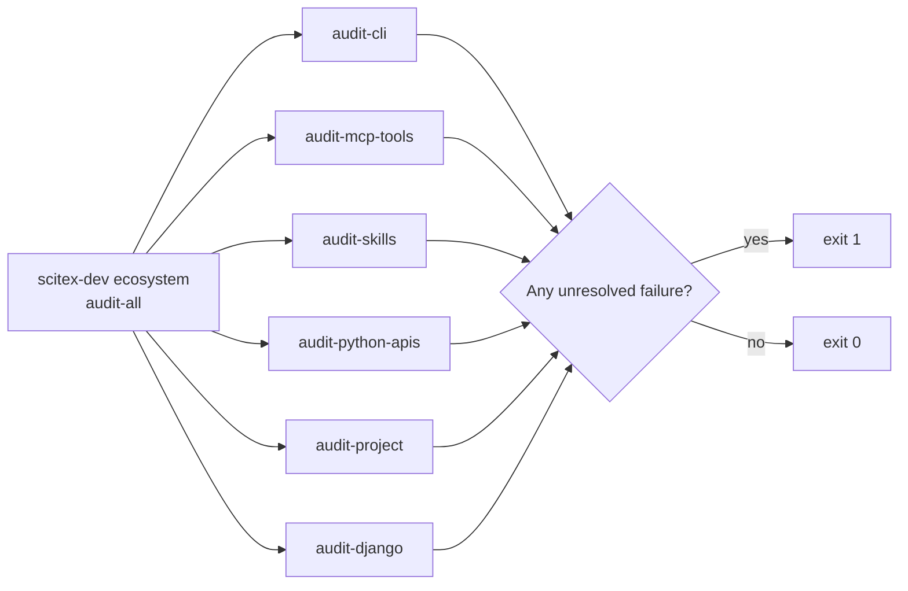

# SciTeX Dev (`scitex-dev`)

<p align="center">
  <a href="https://scitex.ai">
    
  </a>
</p>

<p align="center"><b>Shared developer utilities for the SciTeX ecosystem</b></p>

<p align="center">
  <a href="https://scitex-dev.readthedocs.io/">Full Documentation</a> · <code>uv pip install scitex-dev[all]</code>
</p>

<!-- scitex-badges:start -->
<p align="center">
  <a href="https://pypi.org/project/scitex-dev/"></a>
  <a href="https://pypi.org/project/scitex-dev/"></a>
  <a href="https://github.com/scitex-ai/scitex-dev/actions/workflows/rtd-sphinx-build-on-ubuntu-latest.yml"></a>
  <a href="https://www.gnu.org/licenses/agpl-3.0"></a>
</p>
<p align="center">
  <a href="https://github.com/scitex-ai/scitex-dev/actions/workflows/pytest-matrix-on-ubuntu-py3-11-3-12-3-13.yml"></a>
  <a href="https://github.com/scitex-ai/scitex-dev/actions/workflows/import-smoke-on-ubuntu-py3-12.yml"></a>
  <a href="https://github.com/scitex-ai/scitex-dev/actions/workflows/scitex-dev-quality-audit-on-ubuntu-latest.yml"></a>
  <a href="https://codecov.io/gh/scitex-ai/scitex-dev"></a>
</p>
<!-- scitex-badges:end -->

---

## Problem and Solution

| # | Problem | Solution |
|---|---------|----------|
| 1 | **Ecosystem packages drift apart** -- versions, READMEs, Sphinx setups and interface conventions need consistent checks | **`scitex-dev ecosystem audit-*`** -- shared dispatchers run package, CLI, MCP, Python API, skills and Django checks; `audit-summary` combines cross-package findings |
| 2 | **Skills scattered across ~70 source repos** -- AI agents can't discover them; humans can't review them | **`scitex dev skills list / get / install`** -- discover installed leaf skills and install them into `~/.scitex/dev/skills/` or an explicit `--directory` for your agent |
| 3 | **Source, installed packages and servers show different versions** | **`scitex dev ecosystem list --versions --json`** and **`validate-versions`** report version observations and mismatches. Each leaf owns its qualified release and deployment; inventory and sync commands do not establish release acceptance. See the [Dev release procedure](src/scitex_dev/_skills/scitex-dev/18_full-update.md). |
| 4 | **Bulk renames across 70 repos break cross-references** -- import paths, doc references, symlinks — `sed -i` corrupts something every time | **`scitex-dev rename-symbols`** -- atomic rename with cross-reference updates, regex support, dry-run preview, git-safety guards |
| 5 | **Lint rules drift from the API they enforce** -- a renamed function in figrecipe leaves the rule pointing at a nonexistent symbol, and the bug only shows up months later | **`scitex-dev linter`** (engine, formerly `scitex-linter`) -- aggregates per-package rule plugins via the `scitex_dev.linter.plugins` entry point. Rules ship in the package whose API they enforce, so rename + rule + test land in one PR. Doc-block linting for `.py` / `.ipynb` / `.md` / `.rst`. `scitex-dev linter sweep` walks every package's README + docs in one shot |

## Installation

The base install includes the CLI, MCP server, icon rendering and skills.
Maintainers can add the `all` extra for development and documentation tooling.

```bash
# Everything you need to USE scitex-dev:
pip install scitex-dev

# Plus the maintainer toolchain (pytest, sphinx, ...) — for working ON it:
pip install "scitex-dev[all]"
```

`[all]` adds development and documentation tooling and optional integrations,
including the Flask dashboard and NumPy diagnostics, on top of the base install. Extra names are restricted to
`{all, dev, docs}` by PS-225, because a per-feature extra is something
somebody eventually pins — and a pin naming an extra that does not exist
installs anyway, warns into a log nobody reads, and silently omits the
capability.

Use `scitex dev` when the umbrella is installed. `scitex-dev` provides the
standalone bootstrap CLI.

### Configuration

Copy [`.env.example`](.env.example) to `.env` (gitignored) at your
project root, then edit. CLI flags always override env vars. The full
list (with inline comments) lives in `.env.example`.

<details>
<summary><strong>Local state directories</strong></summary>

<br>

scitex-dev reads optional config + cache from the canonical SciTeX
local-state locations:

| Path                          | Scope         | Purpose                              |
|-------------------------------|---------------|--------------------------------------|
| `~/.scitex/dev/`              | user-global   | per-user config, cache               |
| `<proj-root>/.scitex/dev/`    | project-local | overrides for the current repo       |

Project-local wins when both exist. Both are optional.

</details>

## Architecture

```
scitex_dev/
├── _cli/
│   ├── audit/                ← rule corpus (PA*, PS*, SK*, §*)
│   │   ├── _api/             ← Python-API rules (PA-1xx)
│   │   ├── _project/         ← project-structure rules (PS-1xx, PS-5xx)
│   │   ├── _skills/          ← skill-file rules (SK-1xx)
│   │   └── _summary/         ← CLI/MCP §-rules + audit-all wrapper
│   ├── ecosystem/            ← cross-package commands (audit-all, list, …)
│   └── skills/               ← `scitex-dev dev skills` implementation
├── _ecosystem/               ← shared helpers (skill-quality, ECOSYSTEM map)
├── _skills/                  ← canonical skill-file corpus shipped to agents
└── testing/                  ← `audit_all_for_package` pytest helper
```

Rules and tests follow their owning audit domain. Project rules enter the shared
`RULES` registry through central entries, co-located declarations or package
providers. Co-located defaults live in their rule tuples; the final `_patch`
pass applies severity and slug overrides after all registrations. Tests live
under the corresponding audit modules.

## Demo



The wrapper aggregates auditor exit codes and applies the declared skip-rule
policy. Read the actual exit status and per-auditor findings: a tally of zero
unmasked errors alone does not establish success. Invocation or configuration
errors can return exit code 2.

Illustrative output structure, rather than a current package assessment:

```
=== audit-cli ===
ok    scitex-io: no CLI convention violations

=== audit-mcp-tools ===
ok  scitex-io: no MCP convention violations

=== audit-skills ===
ok  scitex-io: no skills violations

=== audit-python-apis ===
ok  scitex-io: no Python API violations

=== audit-project ===
ok  scitex-io: no project-structure violations
```

Illustrative failure shape:

```
=== audit-project ===
fail  scitex-dsp (/home/ywatanabe/proj/scitex-dsp): 2 error(s)
  [E] [PS-141 §1] README.md: missing mandatory `## Demo` section
  [E] [PS-503 §5] examples/01_demo_out: no FINISHED_SUCCESS/<session_id>/ subdir
```

See [`examples/`](examples/) for runnable demos that exercise
`scitex-dev`'s own commands (search, version-management, docs
aggregation).

## Selective discovery and context accounting

`scitex-dev context measure --input selected-snapshot.json --json` measures
caller-selected advertised MCP definitions and skill headers. The same pure
API is `scitex_dev.measure_context` and the MCP tool is `dev_context_measure`.
`configure_mcp_discovery` reuses FastMCP search after host policy; no custom
search engine or tokenizer is introduced. Reports show JSON bytes/code points,
explicit owner attribution and unknown client context, without echoing tool
descriptions. See [scope, schema and client limits](docs/context-discovery.md).
The umbrella route is `scitex dev context measure` when Dev is installed.

## Five Interfaces

<details>
<summary><strong>Python API ⭐⭐</strong></summary>

Version, CI, documentation and error-handling helpers are re-exported from
`scitex_dev` (internals live under `_release`, `_docs`, `_core`; don't import
those paths). The active-project selector lives in `scitex_dev.project`.

```python
# Discover installed versions and documentation
from scitex_dev import list_versions, get_docs, search
versions = list_versions()
get_docs(package="scitex-writer")
search("save figure")

# Preview changes; applying a plan is a separate action
from scitex_dev import fix_local, preview_rename
fix_local(packages=["scitex-stats"], confirm=False)
preview_rename(pattern="old_name", replacement="new_name", directory=".")

# LLM-friendly types
from scitex_dev import Result, ErrorCode, supports_return_as

# Active project (scitex-dev >=0.62.0)
from scitex_dev.project import resolve_project
resolve_project(explicit="synthetic/owned")
```

`verify_docs_and_skills(package_path, documents=[...])` checks selected
Markdown Python fences against local source without exporting skills or
executing examples. Inspect its `checked_scope`, `unverified` and `limitations`;
it does not prove complete documentation drift coverage. See
[scoped documentation verification](docs/documentation-verification.md).

> Discover and install skills through `scitex-dev dev skills list/get/install`.
> Python discovery/export helpers are public in `scitex_dev.ecosystem`:
> `list_skills`, `get_skill` and `export_skills`; the root module does not
> re-export them.

</details>

<details open>
<summary><strong>CLI Commands ⭐⭐⭐ (primary)</strong></summary>

```bash
# Ecosystem management
scitex-dev ecosystem list
scitex-dev ecosystem list --versions
scitex-dev ecosystem validate-versions --dry-run

# Active project (scitex-dev >=0.62.0)
scitex-dev project use synthetic/owned
scitex-dev project get --json
scitex-dev project clear

# Documentation
scitex-dev docs get
scitex-dev docs search "save figure"

# Bulk rename
scitex-dev rename-symbols old_name new_name --dry-run

# See all commands
scitex-dev --help
scitex-dev --help-recursive
```

Project references are `owner/name` or `all`. Resolution checks an explicit
Python argument first, then `SCITEX_PROJECT`, then the persisted selection
under `$SCITEX_DIR/scitex-dev/active_project` (default
`~/.scitex/scitex-dev/active_project`). `project current` remains a deprecated
alias for `project get`; its warning goes to stderr so JSON stays usable.
Selecting a project does not authorize access to it or establish store
tenancy.

</details>

<details>
<summary><strong>MCP Server ⭐⭐</strong></summary>

```bash
# Start server
scitex-dev mcp start

# Check setup
scitex-dev mcp doctor
scitex-dev mcp list-tools

# Installation info
scitex-dev mcp install
```

**Claude Code setup** — add `.mcp.json` to your project root. The executable
must be available in the client environment; configure supported variables in
that environment rather than relying on an undocumented `.src` loader.

```json
{
  "mcpServers": {
    "scitex-dev": {
      "command": "scitex-dev",
      "args": ["mcp", "start"]
    }
  }
}
```

</details>

<details open>
<summary><strong>Skills ⭐⭐⭐ (primary)</strong></summary>

<br>

Skills provide workflow-oriented guides that AI agents query to discover capabilities and usage patterns.

```bash
scitex dev skills list --package scitex-dev --json
scitex dev skills get scitex-dev SKILL
scitex dev skills install --package scitex-dev --directory /tmp/scitex-skills --dry-run --json
# Review the plan; omit --dry-run to install. Use --link for editable sources.
```

The default store is `~/.scitex/dev/skills/`; `--directory` selects an explicit
external destination, with `--dest` retained as an alias. The standalone
bootstrap command is `scitex-dev dev skills install`. Client discovery and
context selection remain separate from installing the files. The resolved
destination must be outside Git checkouts, including dotfile trees reached
through symlinks. If the default store resolves inside Git, choose an external
`--directory` and preserve the existing store; the installer does not relocate
it or relax that guard.

> **[Full skills directory](https://github.com/scitex-ai/scitex-dev/tree/develop/src/scitex_dev/_skills)**

| Skill | Content |
|-------|---------|
| `result-types` | `Result`, `ErrorCode`, `@supports_return_as` for LLM-friendly responses |
| `cli-mcp-utils` | CLI and MCP utility helpers |
| `config` | Package configuration and priority config patterns |
| `versions` | Version management, mismatch detection and fixing |
| `ecosystem` | Ecosystem list, sync, and commit workflows |
| `rename` | Safe bulk rename with cross-reference updates |
| `docs-search` | Documentation aggregation and unified search |
| `test-runner` | Local and HPC test execution |
| `full-update` / `full-update-deploy` | End-to-end audit → bump → release → sync pipelines |
| `agentic-test-overview` / `-skills` / `-mcp` | Agent-vs-agent quality testing |
| `dynamic-audit` | Cross-package periodic audit checklist |
| `env-vars` | `SCITEX_DEV_*` / `SCITEX_*` environment variable reference |

</details>

<details>
<summary><strong>Web API: leaf contracts, SDK validation, explicit host admission</strong></summary>

scitex-dev dispatches leaf-owned rules and hooks; scitex-sdk owns the Web API
contract. This is not a claim that scitex-dev's legacy Flask dashboard is a
complete public Web API. A missing interface needs an implementation or an
explicit, justified exception.

See [the five-interface audit workflow](src/scitex_dev/_skills/scitex-dev/39_interface-audit.md)
for discovery commands, source evidence and coverage limits. The legacy
`deploy_scitex_hub` helper targets an older deployment layout; use Hub-owned
release and deployment procedures for current services.

</details>

## Part of SciTeX

`scitex-dev` is part of [**SciTeX**](https://scitex.ai). Install via
the umbrella with `pip install scitex[dev]` to use as
`scitex.dev` (Python) or `scitex dev ...` (CLI).

SciTeX follows the Four Freedoms for Research below, inspired by
[the Free Software Definition](https://www.gnu.org/philosophy/free-sw.en.html):

>Four Freedoms for Research
>
>0. The freedom to **run** your research anywhere — your machine, your terms.
>1. The freedom to **study** how every step works — from raw data to final manuscript.
>2. The freedom to **redistribute** your workflows, not just your papers.
>3. The freedom to **modify** any module and share improvements with the community.
>
>AGPL-3.0 — because we believe research infrastructure deserves the same freedoms as the software it runs on.

---

<p align="center">
  <a href="https://scitex.ai">
    
  </a>
</p>


### Federated executable hooks

Leaves register `scitex_dev.hooks` providers and own their `HookRule.check`
implementations. scitex-dev discovers and dispatches these checks without
embedding a package's output, container, or credential policy.

```bash
scitex-dev dev hooks install --provider scitex-logging --harness claude --config .claude/settings.local.json --dry-run
```

Omit `--dry-run` to merge the provider's bindings into native configuration.
Hermes uses `--harness hermes --config <profile>/config.yaml` and its own atomic
writer, so run installation where Hermes is available. Use `--python` when the
target's interpreter differs from the installer. Other settings/providers are
preserved; repeating installation does not duplicate bindings. Native commands
call `python -m scitex_dev.hooks.dispatch --provider <distribution>` with the
harness JSON payload on stdin. A missing provider or failing check refuses
verification with exit code 2. Post-tool checks report after the operation;
only pre-tool events can prevent that operation. Harness approval is separate
from installation and is never silently granted by this installer.
